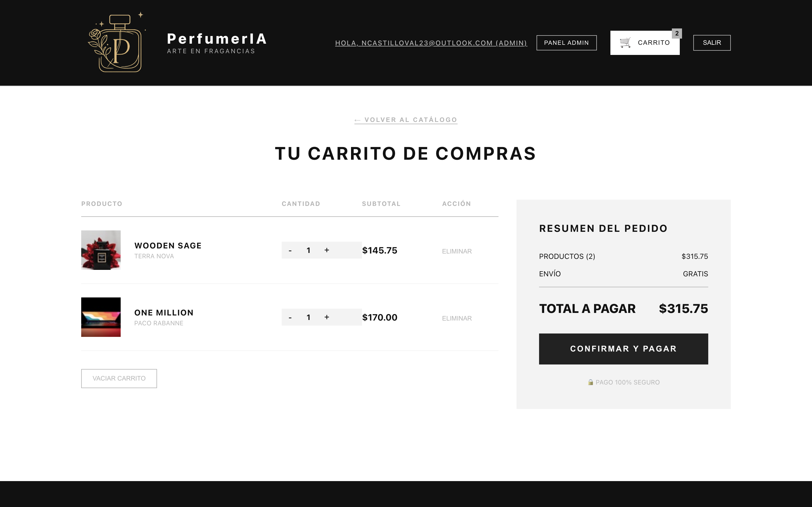
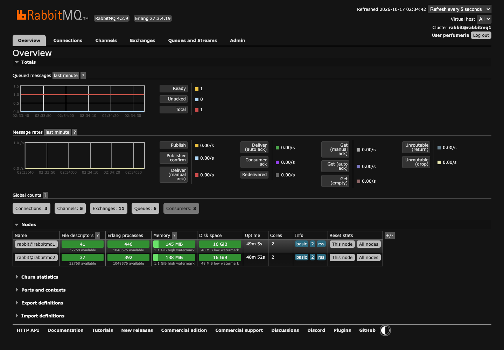

# 1. Resumen ejecutivo

Se incorporó mensajería asíncrona con **RabbitMQ** al sistema PerfumerIA sin
alterar la lógica de negocio existente. La solución incluye un **clúster de dos
nodos** en Docker Compose, **exchanges** topic y direct, **colas** funcionales con
sus **DLQ**, **productores y consumidores** con confirmación manual (ACK) y manejo
explícito de errores, y un **microservicio administrador** que expone una **API
REST** para crear y eliminar colas, exchanges y bindings, validada y protegida.

Todo se desplegó en **AWS EC2**, se publicó el frontend **React** por HTTPS y se
protegió el acceso mediante **AWS API Gateway** con autorizador **JWT** de
**Microsoft Entra ID**. El checkout real desde React genera una orden `PAID` y los
consumidores procesan notificación, documento y envío en segundo plano; un
mensaje inválido termina en su DLQ.

# 2. Objetivos y alcance

- Incorporar colas, exchanges y DLQ para tareas asíncronas (notificaciones,
  documentos, envíos).
- Demostrar que la mensajería desacoplada funciona sin afectar la lógica previa.
- Mantener el frontend **React** (no migrar a Angular) y los microservicios Spring
  Boot existentes, con H2 para la demostración.
- Entregar el código por GitHub y respaldar el informe con capturas reales.

# 3. Arquitectura de la solución

```text
React (MSAL) → API Gateway (JWT) → BFF (:8080) → microservicios
                                      ├── orders-service   (:8082)  productor
                                      ├── shipping-service (:8086)  consumidor
                                      └── rabbit-admin-service (:8087, loopback)
                                                 │
                                            RabbitMQ (clúster 2 nodos)
```

| Propósito | Exchange | Routing key | Cola durable | DLQ durable |
|---|---|---|---|---|
| Aviso de pedido | `perfumeria.orders.topic` (topic) | `orders.*` | `perfumeria.orders.notifications` | `perfumeria.orders.notifications.dlq` |
| Documento de compra | `perfumeria.orders.topic` (topic) | `orders.paid` | `perfumeria.orders.documents` | `perfumeria.orders.documents.dlq` |
| Solicitud de envío | `perfumeria.shipping.direct` (direct) | `shipping.requested` | `perfumeria.shipping.requests` | `perfumeria.shipping.requests.dlq` |
| Rechazos | `perfumeria.dead-letter.direct` (direct) | claves DLQ por dominio | — | bindings a las tres DLQ |

# 4. Paso a paso de implementación

## 4.1 Clúster RabbitMQ con Docker Compose

1. En `infra/rabbitmq` se define un clúster de dos nodos (`rabbitmq1`, `rabbitmq2`)
   con `rabbitmq:4.2-management`, puertos de AMQP y Management solo en loopback.
2. Se levanta y verifica:

```bash
docker compose up -d
docker compose ps
docker compose exec rabbitmq1 rabbitmq-diagnostics cluster_status
```

3. Se confirma que ambos nodos quedan `Running` y saludables.


## 4.2 Configuración centralizada y beans de RabbitMQ

Los **nombres** de colas, exchanges y routing keys viven en `application.yml`
(bloque `app.messaging`), nunca sueltos en el código de negocio. La **declaración**
de `Queue`, `Exchange` y `Binding` se hace con beans en clases de configuración
separadas.

```yaml
app:
  messaging:
    exchanges:
      orders: perfumeria.orders.topic
      shipping: perfumeria.shipping.direct
      dead-letter: perfumeria.dead-letter.direct
    routing-keys:
      order-created: orders.created
      order-paid: orders.paid
      notifications-pattern: orders.*
      shipping-requested: shipping.requested
```

```java
@Configuration
public class OrderRabbitConfiguration {
    @Bean TopicExchange ordersTopicExchange(@Value("${app.messaging.exchanges.orders}") String name) {
        return new TopicExchange(name, true, false);
    }
    @Bean Queue orderDocumentsQueue(
            @Value("${app.messaging.queues.documents}") String name,
            @Value("${app.messaging.exchanges.dead-letter}") String deadLetterExchange,
            @Value("${app.messaging.routing-keys.documents-dead}") String deadLetterRoutingKey) {
        return QueueBuilder.durable(name)
            .deadLetterExchange(deadLetterExchange)
            .deadLetterRoutingKey(deadLetterRoutingKey)
            .build();
    }
    // ... Queue, Exchange y Binding por cada caso de uso
}
```

Clases equivales: `OrderRabbitConfiguration` (orders) y
`ShippingRabbitConfiguration` (shipping).

## 4.3 Productores

`orders-service` publica tres eventos persistentes al confirmar la orden, mediante
`OrderEventPublisher` y `RabbitTemplateOrderMessageSender`, usando el contrato
`OrderMessageSender`. La configuración del `RabbitTemplate` es un bean dedicado,
separado del servicio de negocio.

## 4.4 Consumidores, ACK/NACK, reintentos y DLQ

- `OrderNotificationListener` y `OrderDocumentListener` (dominio **orders**)
  procesan `orders.*` y `orders.paid`.
- `ShipmentRequestedListener` (dominio **shipping**) procesa `shipping.requested`.
- Todos usan `@RabbitListener`, **ACK manual** y una clase de soporte
  `RabbitConsumerSupport` que centraliza:
  - **reintentos** hasta `RABBITMQ_CONSUMER_MAX_ATTEMPTS` (con retardo),
  - **ACK** si el proceso termina bien,
  - **NACK sin requeue** y envío a **DLQ** ante payloads inválidos o reintentos
    agotados.


## 4.5 Microservicio administrador (API REST)

`rabbit-admin-service` encapsula la administración de RabbitMQ en
`RabbitAdminService` (implementa `RabbitAdminOperations`, sobre `AmqpAdmin`). El
controlador expone rutas REST claras y los DTO validan la entrada.

| Operación | Método y ruta |
|---|---|
| Crear cola | `POST /api/rabbitmq/queues` |
| Eliminar cola | `DELETE /api/rabbitmq/queues/{name}` |
| Crear exchange | `POST /api/rabbitmq/exchanges` |
| Eliminar exchange | `DELETE /api/rabbitmq/exchanges/{name}` |
| Crear binding | `POST /api/rabbitmq/bindings` |
| Eliminar binding | `DELETE /api/rabbitmq/bindings` |

El servicio escucha en `127.0.0.1:8087` y se publica a través del **BFF** con el
scope `Admin.Read`.


## 4.6 Integración con el frontend

El **checkout** de React llama al BFF con el scope `Orders.Create`. El carrito se
envía, `orders-service` guarda la orden y publica los eventos; el número y estado
de la orden se muestran al usuario.





## 4.7 Despliegue en AWS EC2

1. Instalación de Docker y Docker Compose en `ec2-user@3.239.252.152` (us-east-1).
2. Clúster de dos nodos arriba y saludable.
3. Servicios backend activos: `bff`, `catalog`, `orders`, `shipping`,
   `rabbit-admin`.
4. Build React servido por **nginx** con TLS (Let's Encrypt) en
   `https://3.239.252.152.sslip.io`.




## 4.8 API Gateway (JWT + rutas + CORS)

1. Las integraciones del API Gateway se apuntaron al BFF (`3.239.252.152:8080`).
2. Se creó la ruta `ANY /api/v1/admin/rabbitmq/{proxy+}` con el autorizador JWT
   `azure-ad` (emisor Entra, audiencia del API) y el scope `Admin.Read`.
3. Se añadió `OPTIONS /api/v1/admin/rabbitmq/{proxy+}` sin autorizador para el
   preflight CORS, con `DELETE` permitido.
4. Verificación: `/api/v1/health` responde `200`; las rutas protegidas responden
   `401` sin token; el preflight responde `200`.


## 4.9 Entra ID (redirect URI)

En la app SPA `16ab7161-5d51-4b03-a5df-3a0c914821a4` se agregó la Redirect URI
`https://3.239.252.152.sslip.io` (tipo *Aplicación de página única*), habilitando
el login desde el hostname de la EC2.

# 5. Cumplimiento de la rúbrica

| # | Indicador | Ponderación | Nivel esperado | Evidencia principal |
|---|---|---:|---|---|
| 1 | Nombres de colas/exchanges/bindings centralizados (`application.yml` o `@Configuration`) | 12% | Muy buen desempeño | `application.yml` + `OrderRabbitConfiguration` |
| 2 | Beans `Queue`, `Exchange`, `Binding` por caso de uso | 13% | Muy buen desempeño | `OrderRabbitConfiguration`, `ShippingRabbitConfiguration` |
| 3 | Separación de lógica de negocio y configuración | 10% | Muy buen desempeño | Paquete `messaging/*` separado del servicio/controlador |
| 4 | Consumidores con `@RabbitListener` agrupados por dominio | 15% | Muy buen desempeño | `OrderNotificationListener`, `OrderDocumentListener`, `ShipmentRequestedListener` |
| 5 | ACK manual y manejo explícito de errores | 20% | Muy buen desempeño | `RabbitConsumerSupport` (ACK/NACK, reintentos, DLQ) |
| 6 | Endpoints REST del microservicio administrador | 13% | Muy buen desempeño | `RabbitAdminController` (`POST /queues`, `DELETE /queues/{name}`, ...) |
| 7 | Lógica encapsulada en un servicio dedicado | 10% | Muy buen desempeño | `RabbitAdminService` (`RabbitAdminOperations`) |
| 8 | Validación de parámetros de entrada | 7% | Muy buen desempeño | DTO con Bean Validation + `ApiExceptionHandler` (`400`) |

# 6. Evidencia por indicador

1. **Centralización (12%)** — Los nombres se leen desde `app.messaging.*` en
   `application.yml`; no hay literales de colas en el código de negocio. Ver
   capturas `05` y `06` (los recursos existen con los nombres declarados).
2. **Beans por caso de uso (13%)** — `OrderRabbitConfiguration` declara un
   `Exchange`/`Queue`/`Binding` por cada flujo (notificación, documento) y las
   DLQ; `ShippingRabbitConfiguration` cubre envíos.
3. **Separación (10%)** — Toda la mensajería está en el paquete `...messaging`;
   los controladores y servicios de dominio solo invocan interfaces
   (`OrderMessageSender`, `RabbitConsumerSupport`).
4. **Consumidores por dominio (15%)** — Ver `10-async-consumers.png`: los logs
   muestran los listeners de orders y shipping procesando cada evento.
5. **ACK y errores (20%)** — Ver `10` (ACK tras procesar) y `11` (payload inválido
   → DLQ). `RabbitConsumerSupport` documenta la política de reintentos/NACK.
6. **API REST (13%)** — Ver `12-rabbit-admin-api.png` (`201` al crear, `204` al
   eliminar).
7. **Servicio dedicado (10%)** — `RabbitAdminService` concentra las operaciones;
   el controlador solo delega.
8. **Validación (7%)** — Ver `12-rabbit-admin-api.png`: nombre reservado `amq.*`
   → `400` con mensaje claro.

# 7. Pruebas ejecutadas

- `mvn test` en `microservice-2`, `shipping-service`, `rabbit-admin-service` y
  `bff`.
- `npm test -- --run` y `npm run build` en `frontend/web-app`.
- Checkout real local y en EC2: orden `PAID`, consumidores procesan notificación,
  documento y envío.
- Payload inválido → `perfumeria.shipping.requests.dlq`.
- CRUD administrativo verificado en local y EC2, incluida la validación `400`.
- Seguridad: rutas protegidas `401` sin token; `Admin.Read` exigido en el BFF.

# 8. Conclusiones

La mensajería asíncrona quedó integrada de extremo a extremo: el frontend dispara
el checkout, el API Gateway valida el JWT de Entra ID, el BFF enruta la operación
y RabbitMQ desacopla las tareas de notificación, documento y envío con DLQ y
manejo de errores. El diseño cumple todos los indicadores de la pauta, con los
nombres centralizados, la configuración separada de la lógica y un microservicio
administrador validado y protegido.

# 9. Anexos

## 9.1 Objetos RabbitMQ

- Exchanges: `perfumeria.orders.topic`, `perfumeria.shipping.direct`,
  `perfumeria.dead-letter.direct`.
- Colas: `perfumeria.orders.notifications`, `perfumeria.orders.documents`,
  `perfumeria.shipping.requests` y sus tres DLQ.

## 9.2 Endpoints del BFF (protegidos)

| Operación | Endpoint |
|---|---|
| Crear cola | `POST /api/v1/admin/rabbitmq/queues` |
| Eliminar cola | `DELETE /api/v1/admin/rabbitmq/queues/{name}` |
| Crear exchange | `POST /api/v1/admin/rabbitmq/exchanges` |
| Eliminar exchange | `DELETE /api/v1/admin/rabbitmq/exchanges/{name}` |
| Crear binding | `POST /api/v1/admin/rabbitmq/bindings` |
| Eliminar binding | `DELETE /api/v1/admin/rabbitmq/bindings` |

## 9.3 Repositorio

`https://github.com/niccastillo23/perfumeria-evaluacion`

## 9.4 Capturas

Listado y detalle completo en `docs/rabbitmq/EVIDENCIAS.md` y en
`docs/evidence/rabbitmq/`.
