# PerfumerIA — RabbitMQ
## Evaluación Parcial N°4 | Desarrollo Cloud Native I (DSY1107)
Integrantes: (completar) · Octubre 2026

# Contexto y arquitectura
- Mensajería asíncrona para tareas de **notificación, documento y envío**.
- Flujo: **React → API Gateway → BFF → microservicios → RabbitMQ**.
- React con MSAL (OAuth2/OIDC); sin alterar la lógica existente.

# API Manager: instancia y configuración
- Instancia de **AWS API Gateway** en funcionamiento (mostrar en consola).
- Rutas integradas al **BFF** (`3.239.252.152:8080`).
- Ruta admin `ANY /api/v1/admin/rabbitmq/{proxy+}` con JWT.

# Validación JWT
- Sin token → **401**; con token válido → **200**.
- Autorizador `azure-ad` (emisor Entra, audiencia del API, scope `Admin.Read`).

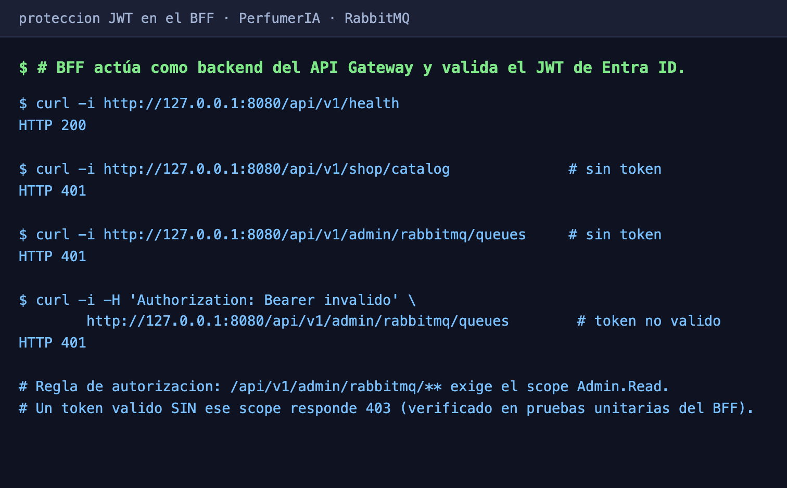

# IDaaS: tenant y usuarios
- **Microsoft Entra ID**: tenant y usuarios registrados (mostrar en portal).
- App SPA con redirect URI `https://3.239.252.152.sslip.io`.

# Frontend con OAuth 2.0 / OIDC
- Login con MSAL y JWT en cada llamada al API Manager.

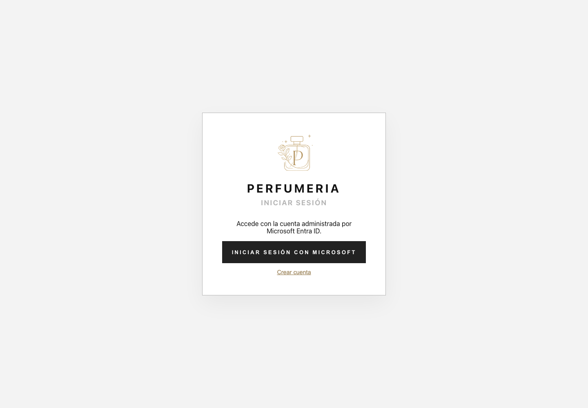

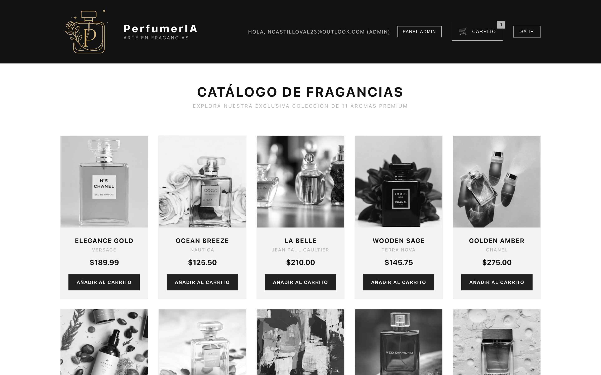

# Despliegue en la nube
- Backend (BFF, catálogo, pedidos, envíos, Rabbit Admin) y frontend **activos**.
- Frontend React por **HTTPS** con nginx + Let's Encrypt.

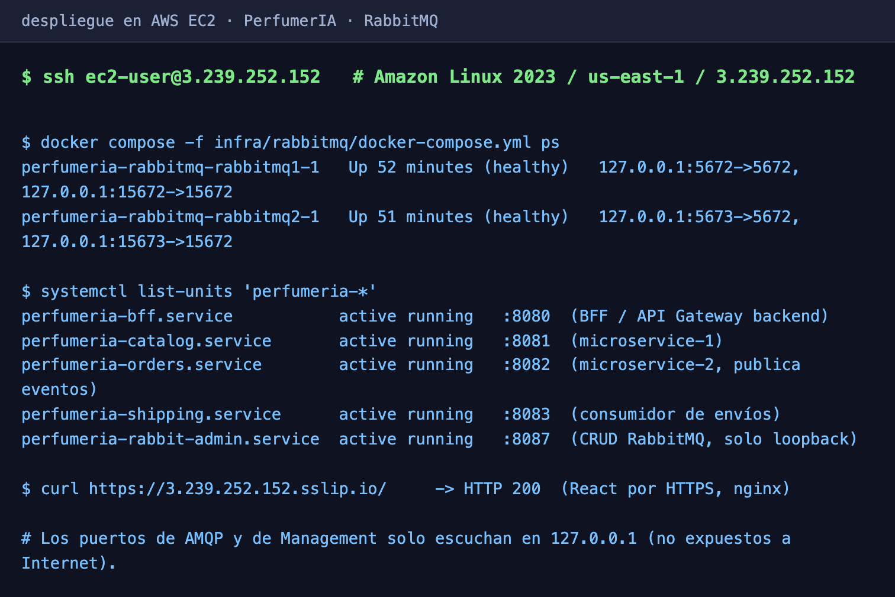

# RabbitMQ con docker-compose
- Dos nodos (`rabbitmq1`, `rabbitmq2`) en **clúster**, saludables.

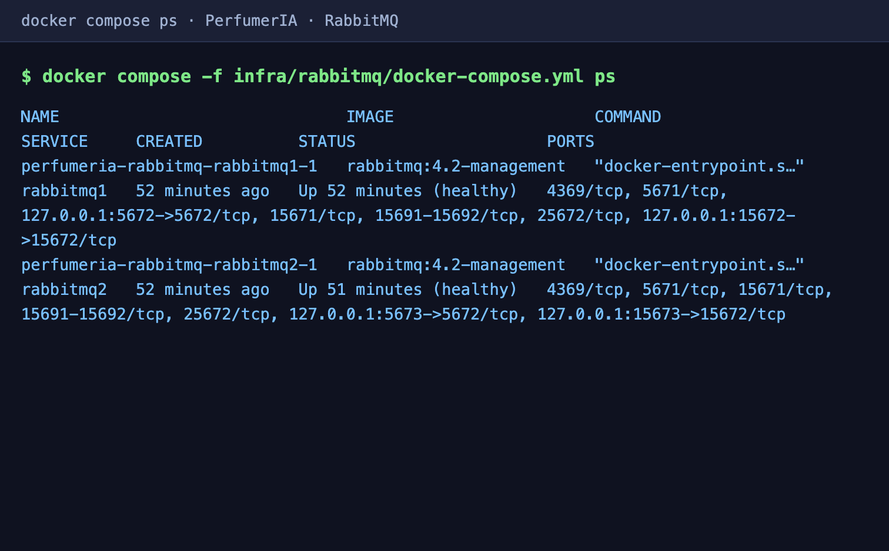

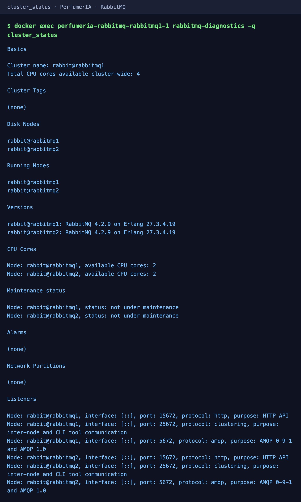

# Exchanges direct y topic
- `perfumeria.orders.topic` (topic) y `perfumeria.shipping.direct` (direct).
- Dead-letter exchange direct para los rechazos.

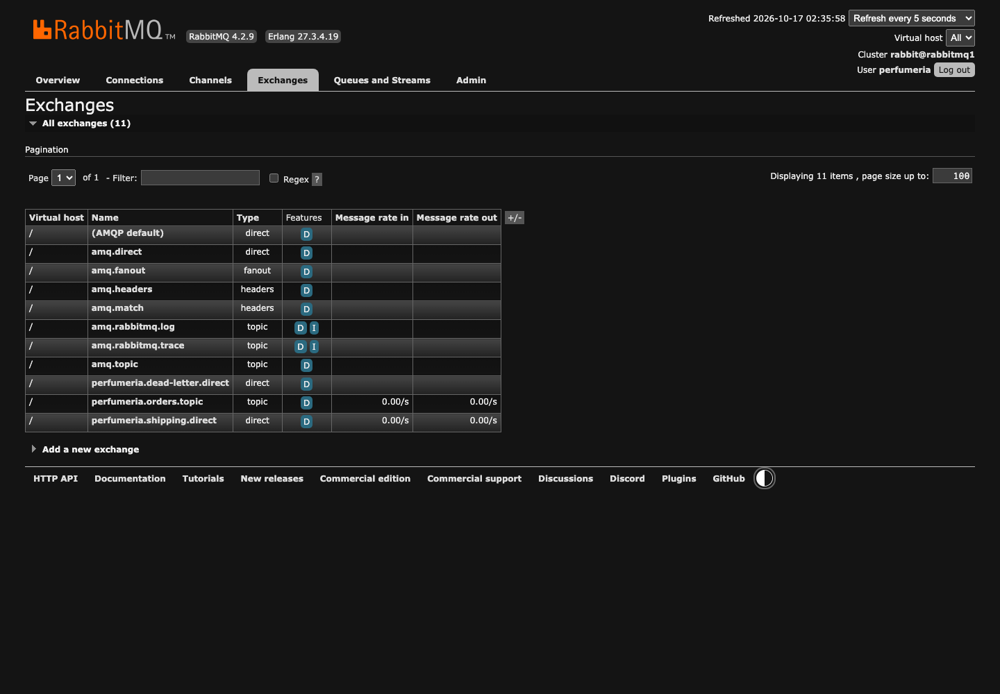

# Colas y DLQ
- Tres colas funcionales y sus tres **DLQ** durables.

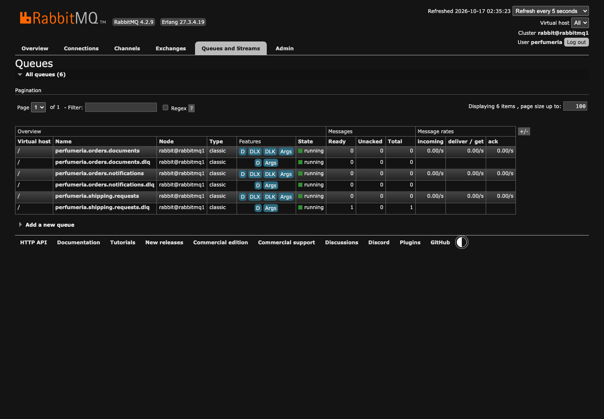

# Consumidores y ACK
- `@RabbitListener` por dominio: notificación, documento y envío.
- **ACK manual** tras procesar; reintentos configurables.

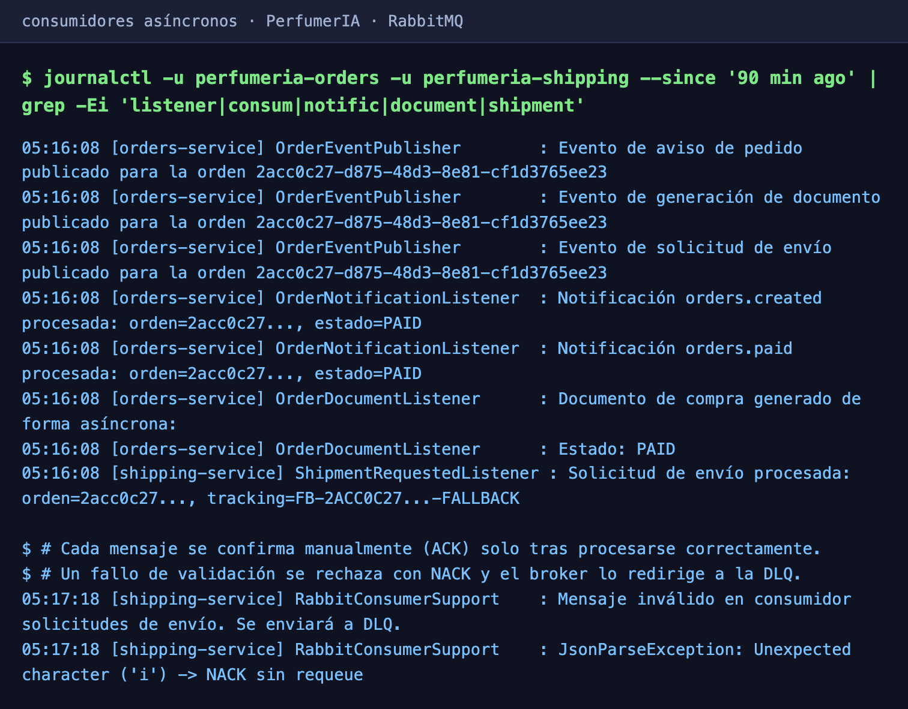

# Manejo de errores → DLQ
- Payload inválido o reintentos agotados → **NACK sin requeue** a la DLQ.

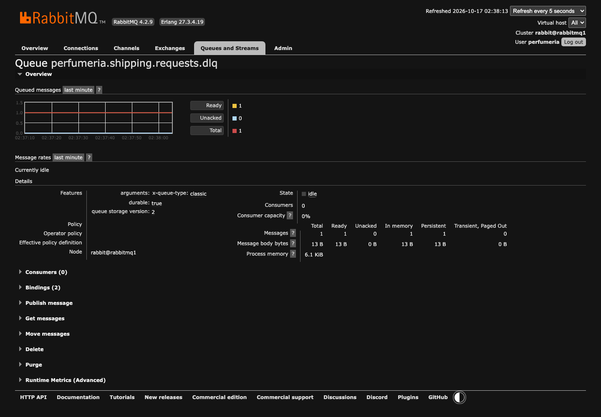

# Administrador REST
- `POST/DELETE` de colas, exchanges y bindings.
- Lógica en `RabbitAdminService`; DTO validados → `400` si el nombre es inválido.

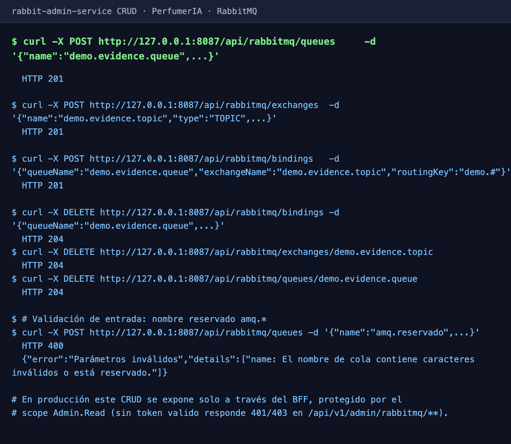

# Cierre
- Desacoplamiento real con **reintentos, DLQ y seguridad JWT**.
- Sin afectar la lógica existente del sistema.
